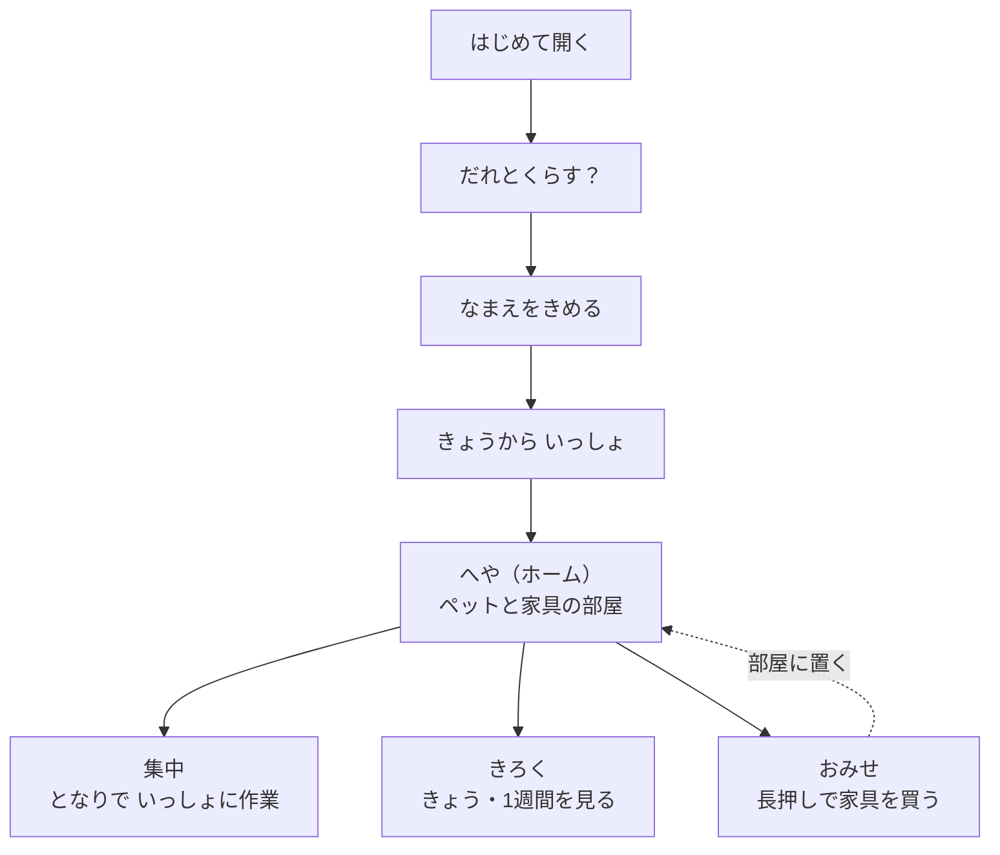
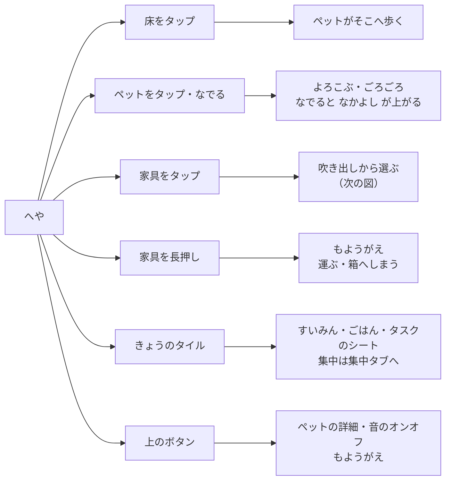
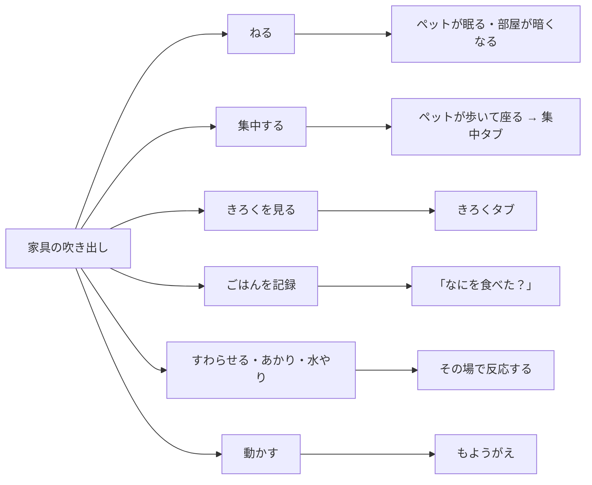
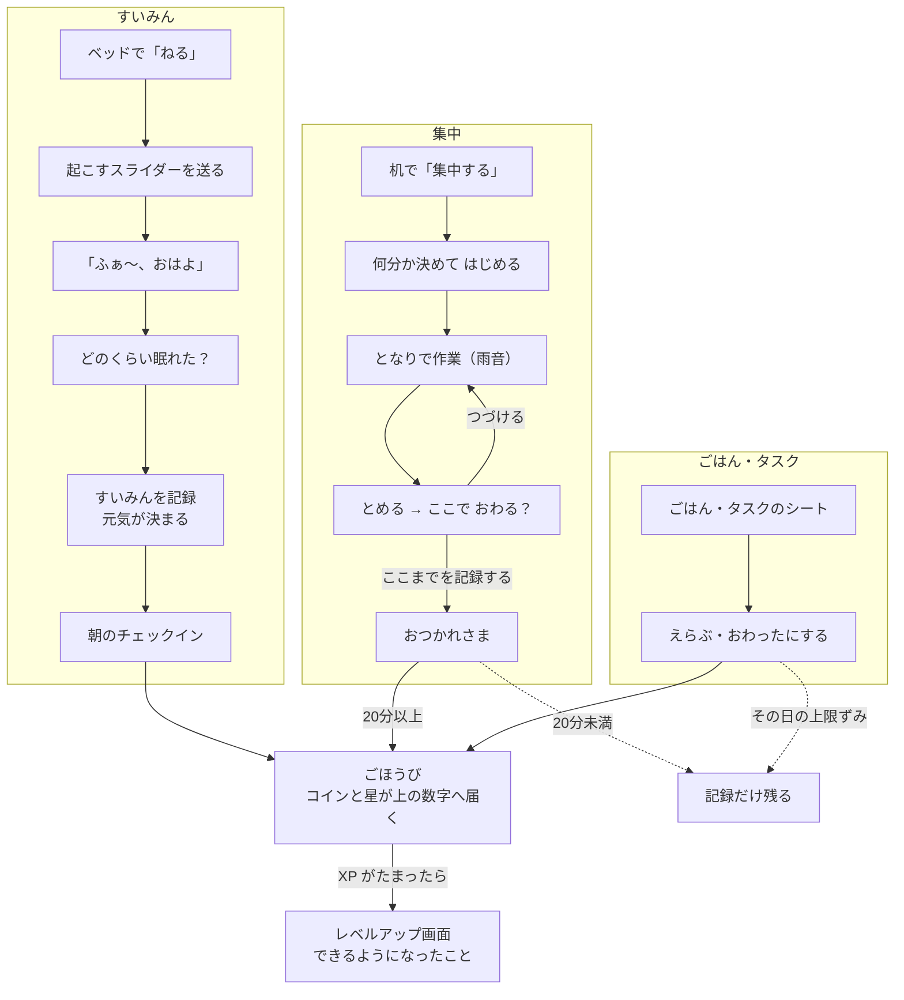

# ユーザーフロー

どの画面からどこへ行けるか、何を記録すると何が返ってくるかを図にしたもの。四角の中の言葉はアプリの表示に合わせている。
図は Mermaid で書いてあり、GitHub ではそのまま図として表示される。

## 全体

はじめて開いたときだけ 4 つの画面を通り、そのあとは「へや」から始まる。下のタブ（へや／集中／きろく／おみせ）でいつでも行き来できる。

## へやでできること

- もようがえ中は「もとにもどす」で 1 つ前に戻せる。「できた」で終わる。
- 元気・おなか・かしこさの数字をタップすると中身が見られる。記録がなくてわからない数字は「不明」と出る。

## 家具の吹き出し

家具をタップすると、その家具でできることが吹き出しで出る。どの家具にも「動かす」がある。

## 記録からごほうびまで

ごほうびの量と 1 日の上限（正本は [src/domain/life.ts](../src/domain/life.ts) の `REWARD_RULES`）:

| 記録 | ごほうび | 1日の上限 |
|---|---|---|
| 朝のチェックイン（起こしてすいみんを記録したとき） | +5 XP・+2 コイン | 1 回 |
| ごはん | +3 XP・+1 コイン | 3 回 |
| 集中（20 分以上） | +10 XP・+4 コイン | 3 回 |
| タスク完了 | +6 XP・+2 コイン | 3 回 |
| なでる | なかよし +2 | 5 回 |
| すいみん | なし（元気が決まる） | — |

- すいみんは、あとから「きょうのタイル」のすいみんで記録することもできる。その場合は朝のチェックインが付かない。
- 上限を超えた記録や 20 分未満の集中も、記録は残る。「きょうの報酬はもう受け取りずみ。記録はちゃんと残るよ」と出る。罰はない。
- コインはおみせで家具を買うのに使う。買った家具は「部屋に置く」で、へやの空いている場所に置かれる。

## きろく

- 「きょう」と「1週間」を切り替えて見られる。
- 一覧の記録を左へスワイプすると消せる（「記録を消した」）。
- 記録がない日のすいみんは「不明」と出る。推測した値は出さない。

## デモ操作

公開版の動作確認用。時刻（朝・昼・夕方・夜・深夜）、ペットの状態、効果音と BGM の切り替え、効果音の聞き比べ、データの初期化ができる。
